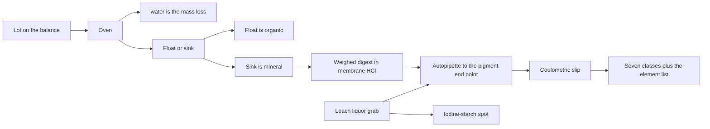
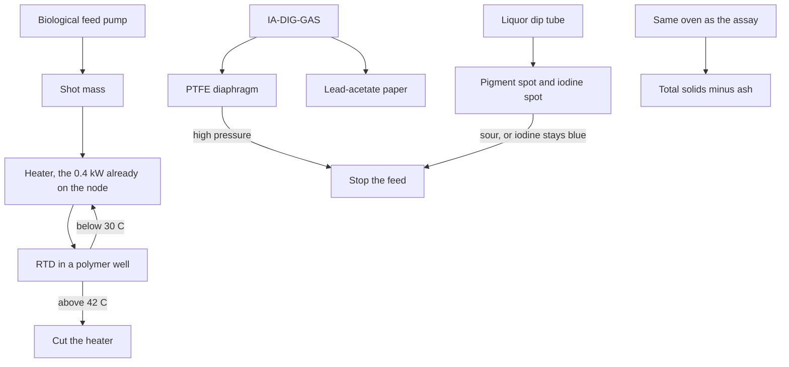
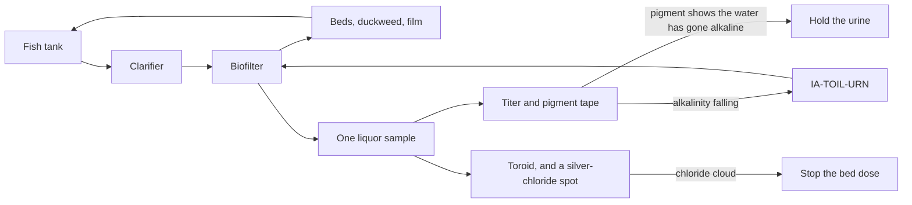

# Instrument loops

Document number: AQS-INST-001
Revision: B
Date: 2026-10-15
Authority: graph Rev BH. Study. Not a PE stamp. Feed schema is AQS-ASSAY-001 Rev C.

| Rev | Description | Date |
| --- | --- | --- |
| A | Assay, digester, and farm loops. Dry reader. No sacrificial electrode. | 2026-10-15 |
| B | Assay loop reports a lot against the seven-class schema. The reference point is not the feed. | 2026-10-15 |

Assay, digester, and farm. One dry reader. The liquor never touches a glass electrode, a platinum pin, or a reference junction. No rate is changed. No edge is added. A band below is a study band, not a set point on the graph.

The duties still say "no trip" on the farm units. This page does not rewrite them.

## 1. What lasts

A sacrificial electrode is a metal or a salt bridge that the chemistry consumes. Chloride leach plates it and poisons the junction. Digester sulfide blacks it and the spent ionic liquid swells the body. Farm water grows a film on it. The replacement is a spot of paper, read by light, then thrown away.

The parts that stay in service:

| Part | Wetted | Why it lasts |
| --- | --- | --- |
| Reflectance head | No | Three LEDs and one silicon photodiode. A white patch on every cassette cancels lamp aging. |
| RTD | Thermowell only | Polymer well. The metal is not in the liquor. |
| Pressure | PTFE diaphragm | No oil fill in contact with gas. |
| Level | Air bubbler or ultrasonic | No float in the liquor. |
| Conductivity | Toroid | Induced current. No electrodes in the water. |
| Balance and oven | The sample cup | Moisture and volatile solids are masses. |

The autopipette is the only moving wetted part. Farm water uses a ceramic piston and HDPE tube. Leach acid and digester liquor use PTFE. The tube is the consumable, not the head.

One reader. Three cassettes. A leach spot, a digester spot, and a fish-water spot never share a tape.

Spent paper:

| Cassette | Where it goes | Why |
| --- | --- | --- |
| Leach and assay | Back with the leach solids | Acid and metal. Not the compost. |
| Digester | With the spent solvent | [Bmim]OAc and stillage. Not the compost. |
| Farm | Compost | The dye is a crop extract. |

No mass is assigned to those returns.

## 2. Paper the plant can make

Bought indicator strips are not a closed loop. The sheet is cellulose from the board mill. The dye is a crop. The acid and the base are the bipolar-membrane pair, taken as the 2 M products already in the duty book.

| Tape | Made from | What it reports |
| --- | --- | --- |
| Pigment | Beet or basil extract, fixed charge of membrane acid | A color change on the weak-acid side of neutral. Farm water and digester liquor. Not strong acid. |
| Iodine-starch | Iodide unit, starch from rice, wheat, or corn | Blue if an oxidant is present. Colorless if the sample is strongly reducing. |
| Lead acetate | Electrowon lead and the acetic acid already made | Blackens in hydrogen sulfide. |

Phenolphthalein, methyl orange, and a universal indicator are not on the solvent route. Phenol and phthalic anhydride are not made. Those dyes are not claimed.

The tape is calibrated with weighed moles, not with a pH meter. A known mass of 2 M acid against a known mass of 2 M base is the equivalence point. The color at that point, and at a known excess of acid or base, is the scale. The number stored is titratable acid or base, in mol/kg. A pH is only a label inside the pigment's change, and it is coarse. Do not record it to two decimals.

Iodine-starch cannot read the methanogenic window. The iodine couple sits near +0.5 V. A healthy digester is far below that. The spot answers one question: has oxygen or another oxidant got in. It does not answer whether the pot is at −200 mV or −300 mV.

## 3. Assay

AQS-ASSAY-001 is a schema, not a feed. A lot is characterized against its seven classes. The reference point on IA-FEED-01 stays until a lot is weighed. This station does not resize the leach, the cells, or the glass line.

IA-FEED-01 is a solid grab, 102.68 kg/d. The leach liquor is a second grab from the same tank. S08 and S16 are solids. They are not run on the liquor tape.

| Step | Class it fills | Method | What it does not do | Actuator | Trip |
| --- | --- | --- | --- | --- | --- |
| 1 | Whole lot | Balance, as received | Does not assume the reference moisture | None | A missed mass voids the lot. |
| 2 | `water` | Oven at a temperature that drives free moisture, then the balance | Does not claim bound water of hydration. Does not assume 0.05. | Oven on the sample, not the tank | None |
| 3 | `organic` against mineral | Float or sink, the same cut the leach uses | Does not split polymer from paper from wood | None | None |
| 4 | `silicate_oxide` and `metal_reactive` | The sink that does not dissolve in the weighed membrane-HCl digest, plus the precipitate that falls when the digest is brought to the pigment end point with membrane base | Does not split Si from Al, Ca, Mg, Ti. Si is reported as the element only after that solid is ashed and the ash is named. SiO₂ is 0.4675 Si by mass. | The pipette | None |
| 5 | `metal_plateable` | Mass of the digest that the coulometric slip can plate, same anode chemistry as the cells | Coulombs are equivalents. They are not Fe against Cu. The element list on the assay page stays unfilled until a separation exists. | The slip cell | None |
| 6 | `other_inorganic` | What is left after water, organic, silicate, reactive metal, and plateable metal, and is still a named salt, sulfide, halide, or phosphate | A remainder that cannot be named is `unassigned`, not this class | None | None |
| 7 | `unassigned` | One minus the six named classes | It is not identified. It is not forced to zero. | None | A lot whose classes do not sum to 1.0 is not a characterized feed. |
| 8 | Liquor acidity | Titrate with weighed 2 M base to the pigment end point | mol/kg of the liquor. Not a pH. Not a class on the solid lot. | The pipette | None. Acidity is a record. |
| 9 | Oxidant in the liquor | Iodine-starch | Colorless is the chloride leach without free oxidant. Blue means chlorate or hypochlorite. | None on the tank | Blue flags the leach. It does not open a new edge. |

The envelope on the edge is the check, not a target. A lot outside it (water above 0.25, plateable metal above 0.35025, silicate above 0.99, organic above 0.30, unassigned above 0.341) is still recorded. It does not resize FLOAT_SINK, the glass line, OIL_DRYER, or a cell. Those units are already named as held.

S08 and S16 keep the deposit table plus the 0.0021 kg/d silicate residual. That residual is an assumption. This station does not replace it with a measurement of the crib until a crib is weighed. Aqueous cells do not make silicon. Silicon on a crib is carried.

## 4. Digester

The vessel is 0.023 m³, 20 days on the whole wet feed, HDPE or PVC. Biological feeds are the fermenter residue, the still, and the ABE stillage. Shop scrap and spent [Bmim]OAc pass through and leave on the solids edge. Sample the liquor. Do not sample the scrap and call it the biology.

Wetted parts on this vessel are PTFE or HDPE. The ionic liquid swells the elastomers that a pH probe is built from. That is why the probe is not fitted.

Gas leaves on IA-DIG-GAS. High pressure already trips the feed. The diaphragm replaces a stored head-plus-10 figure. It does not add a set point.

| Step | Variable | Method | Study band | Actuator | Trip |
| --- | --- | --- | --- | --- | --- |
| 1 | Shot mass | Balance or a timed PTFE pump. No density is assumed. | The edges as drawn | Feed pump | No mass, no credit to the gas edge |
| 2 | Temperature | RTD in a well | 33–38 °C, the Clostridium temperature already used upstream | The 0.4 kW heater | Above 42 °C, cut heat. Methanogens die there. |
| 3 | Pressure | PTFE diaphragm | Atmospheric. The vent is the gas edge. | Feed pump | High pressure stops the feed. Already on the duty. |
| 4 | Liquor acidity | Pigment tape, or a titer if the color is off the band | mol/kg on the weak-acid side of the pigment | Feed pump | Sour liquor stops biological feed. Membrane base is not added. That would be a new edge. |
| 5 | Gross redox | Iodine-starch, read once a day. The holdup is 20 days. | Colorless | Feed pump and the seal | Blue means oxidant in the pot. Stop feed. Do not chase millivolts. |
| 6 | Hydrogen sulfide | Lead-acetate tape on the gas edge | A slow darkening is expected. A fast one is not. | None | Flag only. Gas still goes to EMETH. No scrubber is added. |
| 7 | Volatile solids | Oven, then ash, on the three biological feeds | The missing measurement named on the duty | None | No digestate split is calculated from this page |

Shop scrap and spent solvent are not in the gas. A solids sample that is mostly ionic liquid is the passthrough, not a failed digestion.

## 5. Farm

The living water is one loop. Clarified water enters the biofilter at 47999 kg/d. Urine enters on IA-TOIL-URN at 1.30 kg/d. Nitrate water leaves to the beds, the duckweed, and the film. One sample at the biofilter outlet stands for that water. A pipette on every bed does not.

No Salria, no leach chloride, and no bipolar-membrane acid go into this loop. Iron is already specified as ferric citrate because it precipitates on the weak-acid side of neutral. EDTA is not made.

Residence of the biofilter, if the box were full, is about 9 h. A day is the right paper interval. An hour is the right interval for temperature and conductivity, which are not consumables.

Compost and the fixing bed are not this water. Clover seed goes on castings that are below 40 °C, after the ammonia is gone. That pile gets an RTD. It does not get the fish cassette.

| Step | Where | Variable | Method | Study band | Actuator | Trip |
| --- | --- | --- | --- | --- | --- | --- |
| 1 | Fish tank | Level and temperature | Bubbler or ultrasonic, RTD | The water stays in the tank. Temperature follows the hall. | The circulation already drawn | High level stops the fill. Low level stops the pump. |
| 2 | Clarifier | Turbidity | Transmission through a cuvette on the same photodiode. Not a tape. | A step change, not a unit | The clarifier outlet | A sudden clear or a sudden black flags a short circuit or a die-off. No new valve. |
| 3 | Biofilter outlet | Alkalinity | Autopipette, weighed membrane acid, pigment end point | Falling titer means nitrification is spending the buffer | IA-TOIL-URN, the urine already drawn | Do not add purchased carbonate. |
| 4 | Biofilter outlet | Which side of the pigment | Pigment tape | Stay on the acid side of the change, where the citrate holds iron | Urine dose | If the spot shows alkali, hold urine. Iron drops out of solution on that side. |
| 5 | Biofilter outlet | Salt and chloride | Toroid, then one drop of silver nitrate made from electrowon silver | Conductivity is only a screen. A white cloud is chloride. | The bed-dose pump | Chloride stops the dose to the beds. Surplus already has a path back toward the leach on IA-NUT-LEACH. |
| 6 | Nutrient dose | What is allowed into the beds | The rules already on the nutrient page | Compost, nitrate, citrate iron. Not leach liquor. | Existing dose pumps | A leach-salt cloud trips step 5. |
| 7 | Compost and clover | Pile temperature | RTD | Below 40 °C before seed | None | Above 40 °C, do not seed. Rhizobia die. |
| 8 | Azolla and duckweed | Same water as step 3 | No second chemistry | The biofilter sample | None | None of their own |

Dissolved oxygen is not closed. A luminescence cap needs a dye that is not on the solvent route. A Winkler titer needs a manganese reagent the plant does not issue. The farm page already says dissolved oxygen is a sample, not a trip. It stays that way. Total ammonia and nitrite are the same kind of gap. Nessler's reagent uses mercury and is refused. No method is invented for them.

The potassium gap on the nutrient page is 1090 mg/d, sourced from the urine tank. The urine loop above trims alkalinity inside that existing edge. It does not raise the edge.

## 6. What the loops do not do

- They do not write a weighed assay over the reference point.
- They do not treat a lot outside the envelope as a reason to resize.
- They do not split Fe from Cu, or Si from Al, Ca, Mg, and Ti.
- They do not split volatile solids into a digestate edge.
- They do not put a pH or an ORP number on the graph.
- They do not size a conductor, a bore, or a bed.
- They do not claim free dissolved oxygen, ammonia, or nitrite.
- Lead spots and silver spots are recycled as metal. The mass is not calculated here.
