# Single-line diagram

Document number: AQS-ELEC-002
Former number: AQS-ELEC-001 (renumbered 2026-10-15 to clear a duplicate)
Revision: F
Date: 2026-10-29
Basis: graph Rev BH; AQS-PLAN-007 task X-ELS-03; AQS-ELEC-003 and AQS-ELEC-004.
Source: generated by `docs-authority/_one_line.py` from the electrical edges of the plant graph. Do not edit by hand. This is a study, not a document stamped by a professional engineer.

| Rev | Description | Date |
| --- | --- | --- |
| F | RECT-TRIM feeder added for the trim heaters fed by the rectifier, sized from their rated load (A-M-415). | 2026-10-29 |
| E | Rewritten to DOC_STYLE (AQS-DOC-002): purpose, terms and captions; method and values unchanged. | 2026-10-24 |
| D | D75 grid export: PV at 200 % of requirement, 42 × 60 = 2520 kW inverters, point of common coupling, export meter and interconnection disconnect (IEEE 1547-2018, UL 1741 SB, NEC 2023 705). | 2026-10-15 |
| C | Generated one-line against the load list; buses MCC-1 and PP-1; RECT-EW feeder. | 2026-10-15 |
| B | Inverter feeder 2 AWG; 400 kW retired. | 2026-10-12 |

## Purpose and scope

A single-line (one-line) diagram shows how electrical power flows from the sources to the loads, drawing each three-phase circuit as one line. This page draws the plant's main 480 V bus, lists every load fed from it with its current and breaker size, and compares total demand with the sources and the inverter rating. It covers the main bus, the motor control centre MCC-1, the 208/120 V panel PP-1, the electrowinning rectifier and the grid connection. Cable sizes are in the cable schedule and protection settings in the protection study.

## Terms and method

- Bus: the common conductor that sources feed and loads draw from; here the 480 V bus of the Sol-Ark inverters (`SOL_ARK_60K`).
- Feeder: the circuit from the bus to one load.
- Point of common coupling (PCC): where the plant connects to the utility grid.
- OCPD: overcurrent protective device (breaker or fuse).
- Current is I = P / (√3 × V × power factor), with a study power factor of 0.90. Breakers are the next standard rating in NEC 240.6(A) at or above 125 % of the continuous current.
- A feeder marked "study share" in the Basis column carries an estimated share of a unit's power, not a calculated load.

Figure 1. Single-line diagram of the main bus (stream and edge ids from the plant graph on each line)

```mermaid
flowchart LR

  HYDRO_SET["HYDRO_SET 0.00 kW"] -->|IA-ESS-HYDRO-ELEC| BUS
  ZNBR2["ZNBR2 5.00 kW"] -->|IA-ESS-ZNBR2-DIS| BUS
  BACKUP_GEN["BACKUP_GEN 0.01 kW"] -->|S47| BUS
  FUEL_CELL["FUEL_CELL 4.00 kW"] -->|S51| BUS
  MEOH_FC["MEOH_FC 1.00 kW"] -->|S79| BUS
  PV_ARRAY["PV_ARRAY 351.87 kW"] -->|IA-PV-01| BUS
  BUS(["SOL_ARK_60K 480 V 3φ, 42 × 60 = 2520 kW inverters"])
  BUS --> MCC["MCC-1 480 V 1.2 kW"]
  BUS --> XF["T-1 15 kVA 480–208/120 V"] --> PP["PP-1 0.4 kW"]
  BUS -->|IA-ESS-ZNBR2-CHG| ZNBR2["ZNBR2 6.67 kW"]
  BUS -->|S17| RECTIFIER["RECTIFIER 12.00 kW"]
  BUS -->|S20| GROW_BED["GROW_BED 2.05 kW"]
  BUS -->|IA-PV-CURTAIL| BOUNDARY_EXPORT["BOUNDARY_EXPORT 4.64 kW"]
  BUS -->|S17-BMED| BMED_ACID["BMED_ACID 5.63 kW"]
  BUS -->|SF-ALK_SCRUBBER| ALK_SCRUBBER["ALK_SCRUBBER 1.11 kW"]
  BUS -->|SF-BMED_UPW_POLISH| BMED_UPW_POLISH["BMED_UPW_POLISH 0.02 kW"]
  BUS -->|SF-CRYO_H2| CRYO_H2["CRYO_H2 0.93 kW"]
  BUS -->|SF-GEO_HP| GEO_HP["GEO_HP 0.71 kW"]
  BUS -->|SF-GLASS_DIGEST| GLASS_DIGEST["GLASS_DIGEST 0.09 kW"]
  BUS -->|SF-H2_DRYER| H2_DRYER["H2_DRYER 0.02 kW"]
  BUS -->|SF-LEACH_CSTR_1| LEACH_CSTR_1["LEACH_CSTR_1 0.75 kW"]
  BUS -->|SF-MEOH_SYNTH| MEOH_SYNTH["MEOH_SYNTH 0.74 kW"]
  BUS -->|SF-MFG_SHOP| MFG_SHOP["MFG_SHOP 2.55 kW"]
  BUS -->|SF-NUTRIENT_DOSE| NUTRIENT_DOSE["NUTRIENT_DOSE 0.02 kW"]
  BUS -->|SF-WAFER_FAB| WAFER_FAB["WAFER_FAB 0.41 kW"]
  BUS -->|SF-WET_BENCH| WET_BENCH["WET_BENCH 0.21 kW"]
  BUS -->|SF-LITHO_STUB| LITHO_STUB["LITHO_STUB 0.00 kW"]
  BUS -->|SF-ELECTRODE_COAT| ELECTRODE_COAT["ELECTRODE_COAT 0.08 kW"]
  BUS -->|SF-BLOW_MOLD| BLOW_MOLD["BLOW_MOLD 0.37 kW"]
  BUS -->|SF-SOLAR_PV_CELL| SOLAR_PV_CELL["SOLAR_PV_CELL 0.39 kW"]
  BUS -->|SF-OIL_PYRO| OIL_PYRO["OIL_PYRO 1.66 kW"]
  BUS -->|SF-BLACK_DIGEST| BLACK_DIGEST["BLACK_DIGEST 0.11 kW"]
  BUS -->|SF-CRYO_AHU| CRYO_AHU["CRYO_AHU 0.65 kW"]
  BUS -->|SF-MEOH_FERM| MEOH_FERM["MEOH_FERM 0.02 kW"]
  BUS -->|SF-ACID_POLISH_SCRUB| ACID_POLISH_SCRUB["ACID_POLISH_SCRUB 1.11 kW"]
  BUS -->|SF-NOX_SCRUB| NOX_SCRUB["NOX_SCRUB 0.04 kW"]
  BUS -->|SF-MET_SCRUB| MET_SCRUB["MET_SCRUB 2.12 kW"]
  BUS -->|SF-EVAP_ACID| EVAP_ACID["EVAP_ACID 1.50 kW"]
  BUS -->|SF-EVAP_BASE| EVAP_BASE["EVAP_BASE 1.34 kW"]
  BUS -->|SF-CRYO_ASU| CRYO_ASU["CRYO_ASU 1.66 kW"]
  BUS -->|SF-H2O_ELYZ| H2O_ELYZ["H2O_ELYZ 21.19 kW"]
  BUS -->|SF-IND_MELT| IND_MELT["IND_MELT 0.89 kW"]
  BUS -->|SF-VAC_IND| VAC_IND["VAC_IND 0.00 kW"]
  BUS -->|SF-RF_HEAT| RF_HEAT["RF_HEAT 0.00 kW"]
  BUS -->|SF-HF_GEN| HF_GEN["HF_GEN 0.31 kW"]
  BUS -->|SF-EXT_HALL| EXT_HALL["EXT_HALL 82.13 kW"]
  BUS -->|SF-EVAP_ACID_VS| EVAP_ACID_VS["EVAP_ACID_VS 0.02 kW"]
  BUS -->|SF-VDF_SYN| VDF_SYN["VDF_SYN 0.51 kW"]
  BUS -->|SF-TFE_SYN| TFE_SYN["TFE_SYN 0.40 kW"]
  BUS -->|SF-POLY_F| POLY_F["POLY_F 0.04 kW"]
  BUS -->|SF-FILM_CAST| FILM_CAST["FILM_CAST 0.11 kW"]
  BUS -->|SF-POWDER_RESIN| POWDER_RESIN["POWDER_RESIN 0.02 kW"]
  BUS -->|SF-LITHO_COAT| LITHO_COAT["LITHO_COAT 0.03 kW"]
  BUS -->|SF-LITHO_ALIGN| LITHO_ALIGN["LITHO_ALIGN 0.00 kW"]
  BUS -->|SF-LITHO_DEV| LITHO_DEV["LITHO_DEV 0.01 kW"]
  BUS -->|SF-REMIN| REMIN["REMIN 0.05 kW"]
  BUS -->|SF-AL_POT| AL_POT["AL_POT 5.66 kW"]
  BUS -->|SF-MG_POT| MG_POT["MG_POT 0.34 kW"]
  BUS -->|SF-CA_POT| CA_POT["CA_POT 0.12 kW"]
  BUS -->|SF-TI_CELL| TI_CELL["TI_CELL 0.50 kW"]
  BUS -->|SF-MO_CELL| MO_CELL["MO_CELL 0.11 kW"]
  BUS -->|SF-CR_CELL| CR_CELL["CR_CELL 0.16 kW"]
  BUS -->|SF-FLUX_PREP| FLUX_PREP["FLUX_PREP 0.10 kW"]
  BUS -->|SF-WAX_PATTERN| WAX_PATTERN["WAX_PATTERN 0.50 kW"]
  BUS -->|SF-SHELL_BUILD| SHELL_BUILD["SHELL_BUILD 0.30 kW"]
  BUS -->|SF-SHELL_BURNOUT| SHELL_BURNOUT["SHELL_BURNOUT 0.25 kW"]
  BUS -->|SF-INV_CAST| INV_CAST["INV_CAST 0.15 kW"]
  BUS -->|SF-SHELL_BREAK| SHELL_BREAK["SHELL_BREAK 0.40 kW"]
  BUS -->|SF-VAC_CAST| VAC_CAST["VAC_CAST 0.00 kW"]
  BUS -->|SF-RES_HEAT| RES_HEAT["RES_HEAT 0.00 kW"]
  BUS -->|SF-SINTER| SINTER["SINTER 0.00 kW"]
  BUS -->|SF-FORGE| FORGE["FORGE 0.00 kW"]
  BUS -->|SF-EXTRUDE| EXTRUDE["EXTRUDE 0.00 kW"]
  BUS -->|SF-DRAW| DRAW["DRAW 0.00 kW"]
  BUS -->|SF-COMB_HEAT| COMB_HEAT["COMB_HEAT 0.05 kW"]
  BUS -->|SF-MET_MELT| MET_MELT["MET_MELT 0.24 kW"]
  BUS -->|SF-GAS_ATOMIZER| GAS_ATOMIZER["GAS_ATOMIZER 0.08 kW"]
  BUS -->|SF-COLD_MILL| COLD_MILL["COLD_MILL 0.02 kW"]
  BUS -->|SF-WIRE_DRAW| WIRE_DRAW["WIRE_DRAW 0.02 kW"]
  BUS -->|SF-GEO_HP_CLOSED_LOOP| GEO_HP_CLOSED_LOOP["GEO_HP_CLOSED_LOOP 0.13 kW"]
  BUS -->|SF-SI_REDUCE| SI_REDUCE["SI_REDUCE 0.15 kW"]
  BUS -->|SF-SI_REFINE| SI_REFINE["SI_REFINE 0.57 kW"]
  BUS -->|SF-ACID_PLANT| ACID_PLANT["ACID_PLANT 0.21 kW"]
  BUS -->|SF-NAOH_PLANT| NAOH_PLANT["NAOH_PLANT 0.50 kW"]
  BUS -->|SF-SOLV_PLANT| SOLV_PLANT["SOLV_PLANT 0.03 kW"]
  BUS -->|SF-GREASE_CA| GREASE_CA["GREASE_CA 0.00 kW"]
  BUS -->|SF-GREASE_LI| GREASE_LI["GREASE_LI 0.00 kW"]
  BUS -->|SF-RESIST_SYN| RESIST_SYN["RESIST_SYN 0.00 kW"]
  CB1["CB-1 480 V, 11 inverters, 1000 A"] --> TX1["750 kVA 480 V / 12.47 kV"] --> MV
  CB2["CB-2 480 V, 11 inverters, 1000 A"] --> TX2["750 kVA 480 V / 12.47 kV"] --> MV
  CB3["CB-3 480 V, 10 inverters, 1000 A"] --> TX3["750 kVA 480 V / 12.47 kV"] --> MV
  CB4["CB-4 480 V, 10 inverters, 1000 A"] --> TX4["750 kVA 480 V / 12.47 kV"] --> MV
  MV(["MV collection 12.47 kV (AQS-ELEC-008)"])
  CB1 --- BUS
  MV --> PCC["705.20 disconnect, 705.30 OCPD, ANSI C12.20 bidirectional meter"] --> GRID(["Utility PCC, export up to 2302 kW"])
  BUS --> RECTEW["RECT-EW 9 × 6 V DC channels, 38.7 kW AC"]
```

Table 1. Loads on the main bus, largest first

| Bus | Load | kW | A | Breaker A | Basis |
| --- | --- | --- | --- | --- | --- |
| MCC-1 480 V | HABITATION | 1.16 | 1.5 | 15 | AQS-ELEC-003 calculated |
| PP-1 208/120 V | VCD_TRAIN | 0.23 | 0.7 | 15 | AQS-ELEC-003 calculated |
| PP-1 208/120 V | AFTERBURNER | 0.13 | 0.4 | 15 | AQS-ELEC-003 calculated |
| PP-1 208/120 V | WS_PEROX | 0.03 | 0.1 | 15 | AQS-ELEC-003 calculated |
| SOL_ARK 480 V | EXT_HALL | 82.13 | 109.8 | 150 | graph SF-EXT_HALL |
| SOL_ARK 480 V | RECT-EW (EW_1–EW_9) | 38.66 | 51.7 | 70 | AQS-ELEC-004 bounding AC |
| SOL_ARK 480 V | RECT-TRIM (trim heaters) | 23.26 | 31.1 | 40 | graph IA-Q4A-TRIM, IA-Q4B-TRIM, IA-TRIM-HX5, IA-TRIM-HX6 at rated load (A-M-415) |
| SOL_ARK 480 V | H2O_ELYZ | 21.19 | 28.3 | 40 | graph SF-H2O_ELYZ |
| SOL_ARK 480 V | RECTIFIER | 12.00 | 16.0 | 25 | graph S17 |
| SOL_ARK 480 V | ZNBR2 | 6.67 | 8.9 | 15 | graph IA-ESS-ZNBR2-CHG |
| SOL_ARK 480 V | AL_POT | 5.66 | 7.6 | 15 | graph SF-AL_POT |
| SOL_ARK 480 V | BMED_ACID | 5.63 | 7.5 | 15 | graph S17-BMED |
| SOL_ARK 480 V | MFG_SHOP | 2.55 | 3.4 | 15 | graph SF-MFG_SHOP |
| SOL_ARK 480 V | MET_SCRUB | 2.12 | 2.8 | 15 | graph SF-MET_SCRUB |
| SOL_ARK 480 V | GROW_BED | 2.05 | 2.7 | 15 | graph S20 |
| SOL_ARK 480 V | OIL_PYRO | 1.66 | 2.2 | 15 | graph SF-OIL_PYRO |
| SOL_ARK 480 V | CRYO_ASU | 1.66 | 2.2 | 15 | graph SF-CRYO_ASU |
| SOL_ARK 480 V | EVAP_ACID | 1.50 | 2.0 | 15 | graph SF-EVAP_ACID |
| SOL_ARK 480 V | EVAP_BASE | 1.34 | 1.8 | 15 | graph SF-EVAP_BASE |
| SOL_ARK 480 V | ALK_SCRUBBER | 1.11 | 1.5 | 15 | graph SF-ALK_SCRUBBER |
| SOL_ARK 480 V | ACID_POLISH_SCRUB | 1.11 | 1.5 | 15 | graph SF-ACID_POLISH_SCRUB |
| SOL_ARK 480 V | CRYO_H2 | 0.93 | 1.2 | 15 | graph SF-CRYO_H2 |
| SOL_ARK 480 V | IND_MELT | 0.89 | 1.2 | 15 | graph SF-IND_MELT |
| SOL_ARK 480 V | LEACH_CSTR_1 | 0.75 | 1.0 | 15 | graph SF-LEACH_CSTR_1 |
| SOL_ARK 480 V | MEOH_SYNTH | 0.74 | 1.0 | 15 | graph SF-MEOH_SYNTH |
| SOL_ARK 480 V | GEO_HP | 0.71 | 0.9 | 15 | graph SF-GEO_HP |
| SOL_ARK 480 V | CRYO_AHU | 0.65 | 0.9 | 15 | graph SF-CRYO_AHU |
| SOL_ARK 480 V | SI_REFINE | 0.57 | 0.8 | 15 | graph SF-SI_REFINE |
| SOL_ARK 480 V | VDF_SYN | 0.51 | 0.7 | 15 | graph SF-VDF_SYN |
| SOL_ARK 480 V | NAOH_PLANT | 0.50 | 0.7 | 15 | graph SF-NAOH_PLANT |
| SOL_ARK 480 V | TI_CELL | 0.50 | 0.7 | 15 | graph SF-TI_CELL |
| SOL_ARK 480 V | WAX_PATTERN | 0.50 | 0.7 | 15 | graph SF-WAX_PATTERN |
| SOL_ARK 480 V | WAFER_FAB | 0.41 | 0.5 | 15 | graph SF-WAFER_FAB |
| SOL_ARK 480 V | SHELL_BREAK | 0.40 | 0.5 | 15 | graph SF-SHELL_BREAK |
| SOL_ARK 480 V | TFE_SYN | 0.40 | 0.5 | 15 | graph SF-TFE_SYN |
| SOL_ARK 480 V | SOLAR_PV_CELL | 0.39 | 0.5 | 15 | graph SF-SOLAR_PV_CELL |
| SOL_ARK 480 V | BLOW_MOLD | 0.37 | 4.9 | 15 | graph SF-BLOW_MOLD; feeder on peak 3.7 kW |
| SOL_ARK 480 V | MG_POT | 0.34 | 0.5 | 15 | graph SF-MG_POT |
| SOL_ARK 480 V | HF_GEN | 0.31 | 0.4 | 15 | graph SF-HF_GEN |
| SOL_ARK 480 V | SHELL_BUILD | 0.30 | 0.4 | 15 | graph SF-SHELL_BUILD |
| SOL_ARK 480 V | SHELL_BURNOUT | 0.25 | 0.3 | 15 | graph SF-SHELL_BURNOUT |
| SOL_ARK 480 V | MET_MELT | 0.24 | 0.3 | 15 | graph SF-MET_MELT |
| SOL_ARK 480 V | WET_BENCH | 0.21 | 0.3 | 15 | graph SF-WET_BENCH |
| SOL_ARK 480 V | ACID_PLANT | 0.21 | 0.3 | 15 | graph SF-ACID_PLANT |
| SOL_ARK 480 V | CR_CELL | 0.16 | 0.2 | 15 | graph SF-CR_CELL |
| SOL_ARK 480 V | INV_CAST | 0.15 | 0.2 | 15 | graph SF-INV_CAST |
| SOL_ARK 480 V | SI_REDUCE | 0.15 | 0.2 | 15 | graph SF-SI_REDUCE |
| SOL_ARK 480 V | GEO_HP_CLOSED_LOOP | 0.13 | 0.2 | 15 | graph SF-GEO_HP_CLOSED_LOOP |
| SOL_ARK 480 V | CA_POT | 0.12 | 0.2 | 15 | graph SF-CA_POT |
| SOL_ARK 480 V | MO_CELL | 0.11 | 0.2 | 15 | graph SF-MO_CELL |
| SOL_ARK 480 V | FILM_CAST | 0.11 | 0.1 | 15 | graph SF-FILM_CAST |
| SOL_ARK 480 V | BLACK_DIGEST | 0.11 | 0.1 | 15 | graph SF-BLACK_DIGEST |
| SOL_ARK 480 V | FLUX_PREP | 0.10 | 0.1 | 15 | graph SF-FLUX_PREP |
| SOL_ARK 480 V | GLASS_DIGEST | 0.09 | 0.1 | 15 | graph SF-GLASS_DIGEST |
| SOL_ARK 480 V | GAS_ATOMIZER | 0.08 | 0.1 | 15 | graph SF-GAS_ATOMIZER |
| SOL_ARK 480 V | ELECTRODE_COAT | 0.08 | 0.1 | 15 | graph SF-ELECTRODE_COAT |
| SOL_ARK 480 V | COMB_HEAT | 0.05 | 0.1 | 15 | graph SF-COMB_HEAT |
| SOL_ARK 480 V | REMIN | 0.05 | 0.1 | 15 | graph SF-REMIN |
| SOL_ARK 480 V | POLY_F | 0.04 | 0.1 | 15 | graph SF-POLY_F |
| SOL_ARK 480 V | NOX_SCRUB | 0.04 | 0.1 | 15 | graph SF-NOX_SCRUB |
| SOL_ARK 480 V | SOLV_PLANT | 0.03 | 0.0 | 15 | graph SF-SOLV_PLANT |
| SOL_ARK 480 V | LITHO_COAT | 0.03 | 0.0 | 15 | graph SF-LITHO_COAT |
| SOL_ARK 480 V | NUTRIENT_DOSE | 0.02 | 0.0 | 15 | graph SF-NUTRIENT_DOSE |
| SOL_ARK 480 V | EVAP_ACID_VS | 0.02 | 0.0 | 15 | graph SF-EVAP_ACID_VS |
| SOL_ARK 480 V | MEOH_FERM | 0.02 | 0.0 | 15 | graph SF-MEOH_FERM |
| SOL_ARK 480 V | H2_DRYER | 0.02 | 0.0 | 15 | graph SF-H2_DRYER |
| SOL_ARK 480 V | COLD_MILL | 0.02 | 0.0 | 15 | graph SF-COLD_MILL |
| SOL_ARK 480 V | WIRE_DRAW | 0.02 | 0.0 | 15 | graph SF-WIRE_DRAW |
| SOL_ARK 480 V | BMED_UPW_POLISH | 0.02 | 0.0 | 15 | graph SF-BMED_UPW_POLISH |
| SOL_ARK 480 V | POWDER_RESIN | 0.02 | 0.0 | 15 | graph SF-POWDER_RESIN |
| SOL_ARK 480 V | LITHO_DEV | 0.01 | 0.0 | 15 | graph SF-LITHO_DEV |
| SOL_ARK 480 V | LITHO_ALIGN | 0.00 | 0.0 | 15 | graph SF-LITHO_ALIGN |
| SOL_ARK 480 V | RESIST_SYN | 0.00 | 0.0 | 15 | graph SF-RESIST_SYN |
| SOL_ARK 480 V | GREASE_CA | 0.00 | 0.0 | 15 | graph SF-GREASE_CA |
| SOL_ARK 480 V | LITHO_STUB | 0.00 | 0.0 | 15 | graph SF-LITHO_STUB |
| SOL_ARK 480 V | VAC_IND | 0.00 | 0.0 | 15 | graph SF-VAC_IND |
| SOL_ARK 480 V | RF_HEAT | 0.00 | 0.0 | 15 | graph SF-RF_HEAT |
| SOL_ARK 480 V | VAC_CAST | 0.00 | 0.0 | 15 | graph SF-VAC_CAST |
| SOL_ARK 480 V | RES_HEAT | 0.00 | 0.0 | 15 | graph SF-RES_HEAT |
| SOL_ARK 480 V | SINTER | 0.00 | 0.0 | 15 | graph SF-SINTER |
| SOL_ARK 480 V | FORGE | 0.00 | 0.0 | 15 | graph SF-FORGE |
| SOL_ARK 480 V | EXTRUDE | 0.00 | 0.0 | 15 | graph SF-EXTRUDE |
| SOL_ARK 480 V | DRAW | 0.00 | 0.0 | 15 | graph SF-DRAW |
| SOL_ARK 480 V | GREASE_LI | 0.00 | 0.0 | 15 | graph SF-GREASE_LI |

## Totals

Table 2. Bus totals

| Item | kW |
| --- | --- |
| Sources on the bus (graph edges) | 361.88 |
| Demand on the bus (this page) | 224.72 |
| Inverter rating (SOL_ARK_60K) | 2520.0 |
| Shortfall against sources | -137.17 |
| Shortfall against inverter | -2295.28 |

## Findings

1. Bus demand at the bounding EW case is 224.7 kW against 361.9 kW of graph sources and 42 × 60 = 2520 kW inverters. The RECT-EW feeder alone is 38.7 kW. Supply nameplates follow AQS-ELEC-007 bounding case (X-RSZ-02); the gap between graph sources and bus demand is loads without graph feeds, booked in the X-RSZ-07 sweep.
2. Feeders marked "study share" become calculated as each unit's task 02 closes (X-ELS-02).
3. Most loads have no electrical edge on the graph; only RECTIFIER (S17) and GROW_BED (S20) do. The one-line assigns the rest to MCC-1 and PP-1 by size. Graph electrical edges for them belong to X-ELS-02.
4. The 48 V shop and farm rails stay as AQS-PWR-001 behind RECTIFIER (S17). MFG_SHOP's 12 kW share may overlap the 20 kW shop rail; the overlap is resolved with MFG_SHOP task 02.
5. Grid export (D75, owner decision 2026-10-15). PV is sized at 2.0 x the balancing nameplate (1512 of 3023 kWp). Inverters at the NREL PVWatts DC/AC ratio 1.2: 42 × 60 = 2520 kW inverters. The inverters are split into 4 collection sections at 480 V, each through a pad-mount transformer to the 12.47 kV collection bus; the plant bus hangs on CB-1 (AQS-ELEC-008). Clear-day export at noon with storage full is up to 2302 kW, about 6542 kWh/d. Interconnection: inverters listed to UL 1741 SB and set to IEEE 1547-2018 Category B reactive power and Category III ride-through, unintentional islanding cleared within 2 s; supply-side connection per NEC 2026 705.11 (the 705.12 120 % load-side rule cannot carry this rating); lockable visible-break disconnect at the point of common coupling per 705.20; bidirectional revenue meter ANSI C12.20 class 0.2; loss of the utility trips export per 705.40, the plant bus stays islanded on storage. Utility service size, available fault current and export limit are set by the serving utility's interconnection study (review item, A-M-110).

## Code basis (X-STD-01)

| Check | Governing clause |
| --- | --- |
| Interconnected sources | NFPA 70-2026 Art. 705 |
| Overcurrent protection | NFPA 70-2026 240.6(A), Art. 240 |
| Energy storage | NFPA 70-2026 Art. 706; NFPA 855-2026 |
| Interconnection | IEEE 1547-2018; UL 1741 SB |
| Electrical safety in operation | NFPA 70E-2027; ISO 45001:2018 management system |
