# One line

Document number: AQS-ELEC-002
Revision: D
Date: 2026-10-15
Authority: graph Rev BH; AQS-PLAN-007 X-ELS-03. Generated by `docs-authority/_one_line.py` from the graph electrical edges, AQS-ELEC-003 and AQS-ELEC-004. Study. Not a PE stamp. Breakers per NEC 240.6(A) at 125 % of continuous current; power factor 0.90 (study).

| Rev | Description | Date |
| --- | --- | --- |
| D | D75 grid export: PV at 200 % of requirement, 56 × 60 = 3360 kW inverters, point of common coupling, export meter and interconnection disconnect (IEEE 1547-2018, UL 1741 SB, NEC 2023 705). | 2026-10-15 |
| C | Generated one-line against the load list; buses MCC-1 and PP-1; RECT-EW feeder. | 2026-10-15 |
| B | Inverter feeder 2 AWG; 400 kW retired. | 2026-10-12 |

```mermaid
flowchart LR

  HYDRO_SET["HYDRO_SET 0.00 kW"] -->|IA-ESS-HYDRO-ELEC| BUS
  ZNBR2["ZNBR2 5.00 kW"] -->|IA-ESS-ZNBR2-DIS| BUS
  BACKUP_GEN["BACKUP_GEN 0.01 kW"] -->|S47| BUS
  FUEL_CELL["FUEL_CELL 3.46 kW"] -->|S51| BUS
  MEOH_FC["MEOH_FC 0.50 kW"] -->|S79| BUS
  PV_ARRAY["PV_ARRAY 278.18 kW"] -->|IA-PV-01| BUS
  BUS(["SOL_ARK_60K 480 V 3φ, 56 × 60 = 3360 kW inverters"])
  BUS --> MCC["MCC-1 480 V 3.0 kW"]
  BUS --> XF["T-1 15 kVA 480–208/120 V"] --> PP["PP-1 0.5 kW"]
  BUS -->|IA-ESS-ZNBR2-CHG| ZNBR2["ZNBR2 6.67 kW"]
  BUS -->|S17| RECTIFIER["RECTIFIER 23.32 kW"]
  BUS -->|S20| GROW_BED["GROW_BED 2.25 kW"]
  BUS -->|IA-PV-CURTAIL| BOUNDARY_EXPORT["BOUNDARY_EXPORT 4.64 kW"]
  BUS -->|S17-EW| RECT_EW["RECT_EW 38.66 kW"]
  BUS -->|S17-BMED| BMED_ACID["BMED_ACID 26.93 kW"]
  BUS -->|SF-ALK_SCRUBBER| ALK_SCRUBBER["ALK_SCRUBBER 0.40 kW"]
  BUS -->|SF-BMED_UPW_POLISH| BMED_UPW_POLISH["BMED_UPW_POLISH 0.04 kW"]
  BUS -->|SF-CRYO_H2| CRYO_H2["CRYO_H2 0.56 kW"]
  BUS -->|SF-GEO_HP| GEO_HP["GEO_HP 2.00 kW"]
  BUS -->|SF-GLASS_DIGEST| GLASS_DIGEST["GLASS_DIGEST 0.09 kW"]
  BUS -->|SF-H2_DRYER| H2_DRYER["H2_DRYER 0.30 kW"]
  BUS -->|SF-LEACH_CSTR_1| LEACH_CSTR_1["LEACH_CSTR_1 2.00 kW"]
  BUS -->|SF-MEOH_SYNTH| MEOH_SYNTH["MEOH_SYNTH 0.50 kW"]
  BUS -->|SF-MFG_SHOP| MFG_SHOP["MFG_SHOP 3.98 kW"]
  BUS -->|SF-NUTRIENT_DOSE| NUTRIENT_DOSE["NUTRIENT_DOSE 0.10 kW"]
  BUS -->|SF-WAFER_FAB| WAFER_FAB["WAFER_FAB 2.00 kW"]
  BUS -->|SF-WET_BENCH| WET_BENCH["WET_BENCH 1.00 kW"]
  BUS -->|SF-LITHO_STUB| LITHO_STUB["LITHO_STUB 0.10 kW"]
  BUS -->|SF-ELECTRODE_COAT| ELECTRODE_COAT["ELECTRODE_COAT 0.30 kW"]
  BUS -->|SF-BLOW_MOLD| BLOW_MOLD["BLOW_MOLD 0.50 kW"]
  BUS -->|SF-SOLAR_PV_CELL| SOLAR_PV_CELL["SOLAR_PV_CELL 0.30 kW"]
  BUS -->|SF-ANIMAL_PEN| ANIMAL_PEN["ANIMAL_PEN 0.20 kW"]
  BUS -->|SF-COMPOST| COMPOST["COMPOST 0.10 kW"]
  BUS -->|SF-DIGESTER| DIGESTER["DIGESTER 0.03 kW"]
  BUS -->|SF-EMETH| EMETH["EMETH 0.50 kW"]
  BUS -->|SF-LIGNO_PRE| LIGNO_PRE["LIGNO_PRE 0.80 kW"]
  BUS -->|SF-BOARD_MILL| BOARD_MILL["BOARD_MILL 1.00 kW"]
  BUS -->|SF-HTC| HTC["HTC 0.60 kW"]
  BUS -->|SF-CRYO_ASU| CRYO_ASU["CRYO_ASU 18.00 kW"]
  BUS -->|SF-CRYO_HE| CRYO_HE["CRYO_HE 0.20 kW"]
  BUS -->|SF-CRYO_NE| CRYO_NE["CRYO_NE 0.20 kW"]
  BUS -->|SF-CRYO_KR| CRYO_KR["CRYO_KR 0.20 kW"]
  BUS -->|SF-CRYO_XE| CRYO_XE["CRYO_XE 0.20 kW"]
  BUS -->|SF-CRYO_AR| CRYO_AR["CRYO_AR 0.20 kW"]
  BUS -->|SF-YEAST| YEAST["YEAST 0.20 kW"]
  BUS -->|SF-ABE| ABE["ABE 0.20 kW"]
  BUS -->|SF-ACETOX| ACETOX["ACETOX 0.10 kW"]
  BUS -->|SF-ALD| ALD["ALD 0.10 kW"]
  BUS -->|SF-GLYOXAL| GLYOXAL["GLYOXAL 0.10 kW"]
  BUS -->|SF-FORM| FORM["FORM 0.10 kW"]
  BUS -->|SF-MEAM| MEAM["MEAM 0.10 kW"]
  BUS -->|SF-IMID| IMID["IMID 0.10 kW"]
  BUS -->|SF-QUAT| QUAT["QUAT 0.10 kW"]
  BUS -->|SF-ACEX| ACEX["ACEX 0.10 kW"]
  BUS -->|SF-HNO3| HNO3["HNO3 0.30 kW"]
  BUS -->|SF-BUCL| BUCL["BUCL 0.10 kW"]
  BUS -->|SF-BSFL| BSFL["BSFL 0.10 kW"]
  BUS -->|SF-DUCKWEED| DUCKWEED["DUCKWEED 0.10 kW"]
  BUS -->|SF-WORMS| WORMS["WORMS 0.10 kW"]
  BUS -->|SF-BEES| BEES["BEES 0.10 kW"]
  BUS -->|SF-CHICKENS| CHICKENS["CHICKENS 0.10 kW"]
  BUS -->|SF-GOATS| GOATS["GOATS 0.10 kW"]
  BUS -->|SF-FISH| FISH["FISH 0.10 kW"]
  BUS -->|SF-CRAYFISH| CRAYFISH["CRAYFISH 0.10 kW"]
  BUS -->|SF-AZOLLA| AZOLLA["AZOLLA 0.10 kW"]
  BUS -->|SF-MUSHROOM| MUSHROOM["MUSHROOM 0.10 kW"]
  BUS -->|SF-COMPOST_TOILET| COMPOST_TOILET["COMPOST_TOILET 0.05 kW"]
  BUS -->|SF-NFIX_BED| NFIX_BED["NFIX_BED 0.20 kW"]
  BUS -->|SF-MUSH_STRAW| MUSH_STRAW["MUSH_STRAW 0.15 kW"]
  BUS -->|SF-MUSH_BLOCK| MUSH_BLOCK["MUSH_BLOCK 0.15 kW"]
  BUS -->|SF-AMF| AMF["AMF 0.15 kW"]
  BUS -->|SF-COMPOST_MYC| COMPOST_MYC["COMPOST_MYC 0.05 kW"]
  BUS -->|SF-FRUIT_GUTTER| FRUIT_GUTTER["FRUIT_GUTTER 0.40 kW"]
  BUS -->|SF-VEG_BED| VEG_BED["VEG_BED 0.40 kW"]
  BUS -->|SF-CLARIFIER| CLARIFIER["CLARIFIER 0.30 kW"]
  BUS -->|SF-BIOFILTER| BIOFILTER["BIOFILTER 0.30 kW"]
  BUS -->|SF-FISH_SUMP| FISH_SUMP["FISH_SUMP 0.30 kW"]
  BUS -->|SF-CROP_TOMATO| CROP_TOMATO["CROP_TOMATO 0.05 kW"]
  BUS -->|SF-CROP_CUCUMBER| CROP_CUCUMBER["CROP_CUCUMBER 0.05 kW"]
  BUS -->|SF-CROP_PEPPER| CROP_PEPPER["CROP_PEPPER 0.05 kW"]
  BUS -->|SF-CROP_LETTUCE| CROP_LETTUCE["CROP_LETTUCE 0.05 kW"]
  BUS -->|SF-CROP_SPINACH| CROP_SPINACH["CROP_SPINACH 0.05 kW"]
  BUS -->|SF-CROP_KALE| CROP_KALE["CROP_KALE 0.05 kW"]
  BUS -->|SF-CROP_ALLIUM| CROP_ALLIUM["CROP_ALLIUM 0.05 kW"]
  BUS -->|SF-CROP_BASIL| CROP_BASIL["CROP_BASIL 0.05 kW"]
  BUS -->|SF-CROP_ROSEMARY| CROP_ROSEMARY["CROP_ROSEMARY 0.05 kW"]
  BUS -->|SF-CLOVER| CLOVER["CLOVER 0.20 kW"]
  BUS -->|SF-SEED_BANK| SEED_BANK["SEED_BANK 0.20 kW"]
  BUS -->|SF-STRUVITE| STRUVITE["STRUVITE 0.20 kW"]
  BUS -->|SF-ASH| ASH["ASH 0.20 kW"]
  BUS -->|SF-IODIDE| IODIDE["IODIDE 0.20 kW"]
  BUS -->|SF-NFT| NFT["NFT 0.30 kW"]
  BUS -->|SF-MISTER| MISTER["MISTER 0.30 kW"]
  BUS -->|SF-DUAL_ROOT| DUAL_ROOT["DUAL_ROOT 0.30 kW"]
  BUS -->|SF-AZOLLA_BED| AZOLLA_BED["AZOLLA_BED 0.30 kW"]
  BUS -->|SF-ETOH_STILL| ETOH_STILL["ETOH_STILL 0.30 kW"]
  BUS -->|SF-BUOH_STILL| BUOH_STILL["BUOH_STILL 0.30 kW"]
  BUS -->|SF-PEANUT| PEANUT["PEANUT 0.30 kW"]
  BUS -->|SF-SUNFLOWER| SUNFLOWER["SUNFLOWER 0.30 kW"]
  BUS -->|SF-HAB_SLEEP| HAB_SLEEP["HAB_SLEEP 0.30 kW"]
  BUS -->|SF-HAB_GALLEY| HAB_GALLEY["HAB_GALLEY 0.30 kW"]
  BUS -->|SF-HAB_MED| HAB_MED["HAB_MED 0.30 kW"]
  BUS -->|SF-HAB_WASH| HAB_WASH["HAB_WASH 0.30 kW"]
  BUS -->|SF-EXPANDER| EXPANDER["EXPANDER 0.61 kW"]
  BUS -->|SF-SIC_FURNACE| SIC_FURNACE["SIC_FURNACE 0.30 kW"]
  BUS -->|SF-H2_PURIFIER| H2_PURIFIER["H2_PURIFIER 0.05 kW"]
  BUS -->|SF-EVAP_ACID| EVAP_ACID["EVAP_ACID 1.50 kW"]
  BUS -->|SF-EVAP_BASE| EVAP_BASE["EVAP_BASE 1.32 kW"]
  BUS -->|SF-EXT_HALL| EXT_HALL["EXT_HALL 106.32 kW"]
  BUS -->|SF-EVAP_ACID_VS| EVAP_ACID_VS["EVAP_ACID_VS 0.02 kW"]
  BUS -->|SF-OIL_PYRO| OIL_PYRO["OIL_PYRO 1.60 kW"]
  BUS -->|SF-BLACK_DIGEST| BLACK_DIGEST["BLACK_DIGEST 0.11 kW"]
  BUS -->|SF-BLACK_DEWATER| BLACK_DEWATER["BLACK_DEWATER 0.01 kW"]
  BUS -->|SF-BLACK_PASTEUR| BLACK_PASTEUR["BLACK_PASTEUR 0.06 kW"]
  BUS -->|SF-BLACK_ALK_HOLD| BLACK_ALK_HOLD["BLACK_ALK_HOLD 0.02 kW"]
  BUS -->|SF-H2O_ELYZ| H2O_ELYZ["H2O_ELYZ 26.08 kW"]
  CB1["CB-1 480 V, 10 inverters, 1000 A"] --> TX1["750 kVA 480 V / 12.47 kV"] --> MV
  CB2["CB-2 480 V, 10 inverters, 1000 A"] --> TX2["750 kVA 480 V / 12.47 kV"] --> MV
  CB3["CB-3 480 V, 9 inverters, 1000 A"] --> TX3["750 kVA 480 V / 12.47 kV"] --> MV
  CB4["CB-4 480 V, 9 inverters, 1000 A"] --> TX4["750 kVA 480 V / 12.47 kV"] --> MV
  CB5["CB-5 480 V, 9 inverters, 1000 A"] --> TX5["750 kVA 480 V / 12.47 kV"] --> MV
  CB6["CB-6 480 V, 9 inverters, 1000 A"] --> TX6["750 kVA 480 V / 12.47 kV"] --> MV
  MV(["MV collection 12.47 kV (AQS-ELEC-008)"])
  CB1 --- BUS
  MV --> PCC["705.20 disconnect, 705.30 OCPD, ANSI C12.20 bidirectional meter"] --> GRID(["Utility PCC, export up to 3074 kW"])
  BUS --> RECTEW["RECT-EW 9 × 6 V DC channels, 38.7 kW AC"]
```

| Bus | Load | kW | A | Breaker A | Basis |
| --- | --- | --- | --- | --- | --- |
| MCC-1 480 V | HABITATION | 3.00 | 4.0 | 15 | AQS-ELEC-003 study share |
| PP-1 208/120 V | AFTERBURNER | 0.50 | 1.5 | 15 | AQS-ELEC-003 study share |
| PP-1 208/120 V | WS_PEROX | 0.03 | 0.1 | 15 | AQS-ELEC-003 calculated |
| SOL_ARK 480 V | EXT_HALL | 106.32 | 142.1 | 200 | graph SF-EXT_HALL |
| SOL_ARK 480 V | RECT_EW | 38.66 | 51.7 | 70 | graph S17-EW |
| SOL_ARK 480 V | BMED_ACID | 26.93 | 36.0 | 50 | graph S17-BMED |
| SOL_ARK 480 V | H2O_ELYZ | 26.08 | 34.9 | 50 | graph SF-H2O_ELYZ |
| SOL_ARK 480 V | RECTIFIER | 23.32 | 31.2 | 40 | graph S17 |
| SOL_ARK 480 V | CRYO_ASU | 18.00 | 24.1 | 40 | graph SF-CRYO_ASU |
| SOL_ARK 480 V | ZNBR2 | 6.67 | 80.2 | 110 | graph IA-ESS-ZNBR2-CHG; feeder on peak 60.0 kW |
| SOL_ARK 480 V | MFG_SHOP | 3.98 | 51.5 | 70 | graph SF-MFG_SHOP; feeder on peak 38.5 kW |
| SOL_ARK 480 V | GROW_BED | 2.25 | 3.0 | 15 | graph S20 |
| SOL_ARK 480 V | GEO_HP | 2.00 | 2.7 | 15 | graph SF-GEO_HP |
| SOL_ARK 480 V | LEACH_CSTR_1 | 2.00 | 2.7 | 15 | graph SF-LEACH_CSTR_1 |
| SOL_ARK 480 V | WAFER_FAB | 2.00 | 2.7 | 15 | graph SF-WAFER_FAB |
| SOL_ARK 480 V | OIL_PYRO | 1.60 | 2.1 | 15 | graph SF-OIL_PYRO |
| SOL_ARK 480 V | EVAP_ACID | 1.50 | 2.0 | 15 | graph SF-EVAP_ACID |
| SOL_ARK 480 V | EVAP_BASE | 1.32 | 1.8 | 15 | graph SF-EVAP_BASE |
| SOL_ARK 480 V | WET_BENCH | 1.00 | 1.3 | 15 | graph SF-WET_BENCH |
| SOL_ARK 480 V | BOARD_MILL | 1.00 | 1.3 | 15 | graph SF-BOARD_MILL |
| SOL_ARK 480 V | LIGNO_PRE | 0.80 | 1.1 | 15 | graph SF-LIGNO_PRE |
| SOL_ARK 480 V | EXPANDER | 0.61 | 0.8 | 15 | graph SF-EXPANDER |
| SOL_ARK 480 V | HTC | 0.60 | 0.8 | 15 | graph SF-HTC |
| SOL_ARK 480 V | CRYO_H2 | 0.56 | 0.8 | 15 | graph SF-CRYO_H2 |
| SOL_ARK 480 V | MEOH_SYNTH | 0.50 | 0.7 | 15 | graph SF-MEOH_SYNTH |
| SOL_ARK 480 V | BLOW_MOLD | 0.50 | 0.7 | 15 | graph SF-BLOW_MOLD |
| SOL_ARK 480 V | EMETH | 0.50 | 0.7 | 15 | graph SF-EMETH |
| SOL_ARK 480 V | ALK_SCRUBBER | 0.40 | 0.5 | 15 | graph SF-ALK_SCRUBBER |
| SOL_ARK 480 V | FRUIT_GUTTER | 0.40 | 0.5 | 15 | graph SF-FRUIT_GUTTER |
| SOL_ARK 480 V | VEG_BED | 0.40 | 0.5 | 15 | graph SF-VEG_BED |
| SOL_ARK 480 V | H2_DRYER | 0.30 | 0.4 | 15 | graph SF-H2_DRYER |
| SOL_ARK 480 V | ELECTRODE_COAT | 0.30 | 0.4 | 15 | graph SF-ELECTRODE_COAT |
| SOL_ARK 480 V | SOLAR_PV_CELL | 0.30 | 0.4 | 15 | graph SF-SOLAR_PV_CELL |
| SOL_ARK 480 V | HNO3 | 0.30 | 0.4 | 15 | graph SF-HNO3 |
| SOL_ARK 480 V | CLARIFIER | 0.30 | 0.4 | 15 | graph SF-CLARIFIER |
| SOL_ARK 480 V | BIOFILTER | 0.30 | 0.4 | 15 | graph SF-BIOFILTER |
| SOL_ARK 480 V | FISH_SUMP | 0.30 | 0.4 | 15 | graph SF-FISH_SUMP |
| SOL_ARK 480 V | NFT | 0.30 | 0.4 | 15 | graph SF-NFT |
| SOL_ARK 480 V | MISTER | 0.30 | 0.4 | 15 | graph SF-MISTER |
| SOL_ARK 480 V | DUAL_ROOT | 0.30 | 0.4 | 15 | graph SF-DUAL_ROOT |
| SOL_ARK 480 V | AZOLLA_BED | 0.30 | 0.4 | 15 | graph SF-AZOLLA_BED |
| SOL_ARK 480 V | ETOH_STILL | 0.30 | 0.4 | 15 | graph SF-ETOH_STILL |
| SOL_ARK 480 V | BUOH_STILL | 0.30 | 0.4 | 15 | graph SF-BUOH_STILL |
| SOL_ARK 480 V | PEANUT | 0.30 | 0.4 | 15 | graph SF-PEANUT |
| SOL_ARK 480 V | SUNFLOWER | 0.30 | 0.4 | 15 | graph SF-SUNFLOWER |
| SOL_ARK 480 V | HAB_SLEEP | 0.30 | 0.4 | 15 | graph SF-HAB_SLEEP |
| SOL_ARK 480 V | HAB_GALLEY | 0.30 | 0.4 | 15 | graph SF-HAB_GALLEY |
| SOL_ARK 480 V | HAB_MED | 0.30 | 0.4 | 15 | graph SF-HAB_MED |
| SOL_ARK 480 V | HAB_WASH | 0.30 | 0.4 | 15 | graph SF-HAB_WASH |
| SOL_ARK 480 V | SIC_FURNACE | 0.30 | 0.4 | 15 | graph SF-SIC_FURNACE |
| SOL_ARK 480 V | ANIMAL_PEN | 0.20 | 0.3 | 15 | graph SF-ANIMAL_PEN |
| SOL_ARK 480 V | CRYO_HE | 0.20 | 0.3 | 15 | graph SF-CRYO_HE |
| SOL_ARK 480 V | CRYO_NE | 0.20 | 0.3 | 15 | graph SF-CRYO_NE |
| SOL_ARK 480 V | CRYO_KR | 0.20 | 0.3 | 15 | graph SF-CRYO_KR |
| SOL_ARK 480 V | CRYO_XE | 0.20 | 0.3 | 15 | graph SF-CRYO_XE |
| SOL_ARK 480 V | CRYO_AR | 0.20 | 0.3 | 15 | graph SF-CRYO_AR |
| SOL_ARK 480 V | YEAST | 0.20 | 0.3 | 15 | graph SF-YEAST |
| SOL_ARK 480 V | ABE | 0.20 | 0.3 | 15 | graph SF-ABE |
| SOL_ARK 480 V | NFIX_BED | 0.20 | 0.3 | 15 | graph SF-NFIX_BED |
| SOL_ARK 480 V | CLOVER | 0.20 | 0.3 | 15 | graph SF-CLOVER |
| SOL_ARK 480 V | SEED_BANK | 0.20 | 0.3 | 15 | graph SF-SEED_BANK |
| SOL_ARK 480 V | STRUVITE | 0.20 | 0.3 | 15 | graph SF-STRUVITE |
| SOL_ARK 480 V | ASH | 0.20 | 0.3 | 15 | graph SF-ASH |
| SOL_ARK 480 V | IODIDE | 0.20 | 0.3 | 15 | graph SF-IODIDE |
| SOL_ARK 480 V | MUSH_STRAW | 0.15 | 0.2 | 15 | graph SF-MUSH_STRAW |
| SOL_ARK 480 V | MUSH_BLOCK | 0.15 | 0.2 | 15 | graph SF-MUSH_BLOCK |
| SOL_ARK 480 V | AMF | 0.15 | 0.2 | 15 | graph SF-AMF |
| SOL_ARK 480 V | BLACK_DIGEST | 0.11 | 0.1 | 15 | graph SF-BLACK_DIGEST |
| SOL_ARK 480 V | NUTRIENT_DOSE | 0.10 | 0.1 | 15 | graph SF-NUTRIENT_DOSE |
| SOL_ARK 480 V | LITHO_STUB | 0.10 | 0.1 | 15 | graph SF-LITHO_STUB |
| SOL_ARK 480 V | COMPOST | 0.10 | 0.1 | 15 | graph SF-COMPOST |
| SOL_ARK 480 V | ACETOX | 0.10 | 0.1 | 15 | graph SF-ACETOX |
| SOL_ARK 480 V | ALD | 0.10 | 0.1 | 15 | graph SF-ALD |
| SOL_ARK 480 V | GLYOXAL | 0.10 | 0.1 | 15 | graph SF-GLYOXAL |
| SOL_ARK 480 V | FORM | 0.10 | 0.1 | 15 | graph SF-FORM |
| SOL_ARK 480 V | MEAM | 0.10 | 0.1 | 15 | graph SF-MEAM |
| SOL_ARK 480 V | IMID | 0.10 | 0.1 | 15 | graph SF-IMID |
| SOL_ARK 480 V | QUAT | 0.10 | 0.1 | 15 | graph SF-QUAT |
| SOL_ARK 480 V | ACEX | 0.10 | 0.1 | 15 | graph SF-ACEX |
| SOL_ARK 480 V | BUCL | 0.10 | 0.1 | 15 | graph SF-BUCL |
| SOL_ARK 480 V | BSFL | 0.10 | 0.1 | 15 | graph SF-BSFL |
| SOL_ARK 480 V | DUCKWEED | 0.10 | 0.1 | 15 | graph SF-DUCKWEED |
| SOL_ARK 480 V | WORMS | 0.10 | 0.1 | 15 | graph SF-WORMS |
| SOL_ARK 480 V | BEES | 0.10 | 0.1 | 15 | graph SF-BEES |
| SOL_ARK 480 V | CHICKENS | 0.10 | 0.1 | 15 | graph SF-CHICKENS |
| SOL_ARK 480 V | GOATS | 0.10 | 0.1 | 15 | graph SF-GOATS |
| SOL_ARK 480 V | FISH | 0.10 | 0.1 | 15 | graph SF-FISH |
| SOL_ARK 480 V | CRAYFISH | 0.10 | 0.1 | 15 | graph SF-CRAYFISH |
| SOL_ARK 480 V | AZOLLA | 0.10 | 0.1 | 15 | graph SF-AZOLLA |
| SOL_ARK 480 V | MUSHROOM | 0.10 | 0.1 | 15 | graph SF-MUSHROOM |
| SOL_ARK 480 V | GLASS_DIGEST | 0.09 | 0.1 | 15 | graph SF-GLASS_DIGEST |
| SOL_ARK 480 V | BLACK_PASTEUR | 0.06 | 0.1 | 15 | graph SF-BLACK_PASTEUR |
| SOL_ARK 480 V | COMPOST_TOILET | 0.05 | 0.1 | 15 | graph SF-COMPOST_TOILET |
| SOL_ARK 480 V | COMPOST_MYC | 0.05 | 0.1 | 15 | graph SF-COMPOST_MYC |
| SOL_ARK 480 V | CROP_TOMATO | 0.05 | 0.1 | 15 | graph SF-CROP_TOMATO |
| SOL_ARK 480 V | CROP_CUCUMBER | 0.05 | 0.1 | 15 | graph SF-CROP_CUCUMBER |
| SOL_ARK 480 V | CROP_PEPPER | 0.05 | 0.1 | 15 | graph SF-CROP_PEPPER |
| SOL_ARK 480 V | CROP_LETTUCE | 0.05 | 0.1 | 15 | graph SF-CROP_LETTUCE |
| SOL_ARK 480 V | CROP_SPINACH | 0.05 | 0.1 | 15 | graph SF-CROP_SPINACH |
| SOL_ARK 480 V | CROP_KALE | 0.05 | 0.1 | 15 | graph SF-CROP_KALE |
| SOL_ARK 480 V | CROP_ALLIUM | 0.05 | 0.1 | 15 | graph SF-CROP_ALLIUM |
| SOL_ARK 480 V | CROP_BASIL | 0.05 | 0.1 | 15 | graph SF-CROP_BASIL |
| SOL_ARK 480 V | CROP_ROSEMARY | 0.05 | 0.1 | 15 | graph SF-CROP_ROSEMARY |
| SOL_ARK 480 V | H2_PURIFIER | 0.05 | 0.1 | 15 | graph SF-H2_PURIFIER |
| SOL_ARK 480 V | BMED_UPW_POLISH | 0.04 | 0.1 | 15 | graph SF-BMED_UPW_POLISH |
| SOL_ARK 480 V | DIGESTER | 0.03 | 0.0 | 15 | graph SF-DIGESTER |
| SOL_ARK 480 V | EVAP_ACID_VS | 0.02 | 0.0 | 15 | graph SF-EVAP_ACID_VS |
| SOL_ARK 480 V | BLACK_ALK_HOLD | 0.02 | 0.0 | 15 | graph SF-BLACK_ALK_HOLD |
| SOL_ARK 480 V | BLACK_DEWATER | 0.01 | 0.0 | 15 | graph SF-BLACK_DEWATER |

## Totals

| Item | kW |
| --- | --- |
| Sources on the bus (graph edges) | 287.15 |
| Demand on the bus (this page) | 285.86 |
| Inverter rating (SOL_ARK_60K) | 3360.0 |
| Shortfall against sources | -1.29 |
| Shortfall against inverter | -3074.14 |

## Findings

1. Bus demand at the bounding EW case is 285.9 kW against 287.1 kW of graph sources and 56 × 60 = 3360 kW inverters. The RECT-EW feeder alone is 38.7 kW. Supply nameplates follow AQS-ELEC-007 bounding case (X-RSZ-02); the gap between graph sources and bus demand is loads without graph feeds, booked in the X-RSZ-07 sweep.
2. 2 feeders are study shares; they become calculated as each unit's task 02 closes (X-ELS-02).
3. Most loads have no electrical edge on the graph; only RECTIFIER (S17) and GROW_BED (S20) do. The one-line assigns the rest to MCC-1 and PP-1 by size. Graph electrical edges for them belong to X-ELS-02.
4. The 48 V shop and farm rails stay as AQS-PWR-001 behind RECTIFIER (S17). MFG_SHOP's 12 kW share may overlap the 20 kW shop rail; the overlap is resolved with MFG_SHOP task 02.
5. Grid export (D75, owner decision 2026-10-15). PV is sized at 2.0 x the balancing nameplate (1982 of 3963 kWp). Inverters at the NREL PVWatts DC/AC ratio 1.2: 56 × 60 = 3360 kW inverters. The inverters are split into 6 collection sections at 480 V, each through a pad-mount transformer to the 12.47 kV collection bus; the plant bus hangs on CB-1 (AQS-ELEC-008). Clear-day export at noon with storage full is up to 3074 kW, about 8576 kWh/d. Interconnection: inverters listed to UL 1741 SB and set to IEEE 1547-2018 Category B reactive power and Category III ride-through, unintentional islanding cleared within 2 s; supply-side connection per NEC 2023 705.11 (the 705.12 120 % load-side rule cannot carry this rating); lockable visible-break disconnect at the point of common coupling per 705.20; bidirectional revenue meter ANSI C12.20 class 0.2; loss of the utility trips export per 705.40, the plant bus stays islanded on storage. Utility service size, available fault current and export limit are set by the serving utility's interconnection study (review item, A-M-110).

## Code basis (X-STD-01)

| Check | Governing clause |
| --- | --- |
| Interconnected sources | NFPA 70-2023 Art. 705 |
| Overcurrent protection | NFPA 70-2023 240.6(A), Art. 240 |
| Energy storage | NFPA 70-2023 Art. 706; NFPA 855-2023 |
| Interconnection | IEEE 1547-2018; UL 1741 SB |
| Electrical safety in operation | NFPA 70E-2024; ISO 45001:2018 management system |
