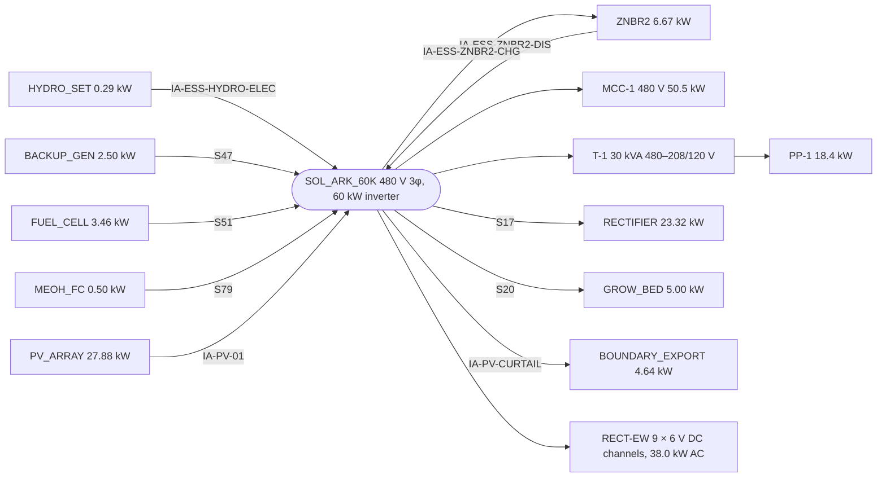

# One line

Document number: AQS-ELEC-002
Revision: C
Date: 2026-10-15
Authority: graph Rev BH; AQS-PLAN-007 X-ELS-03. Generated by `docs-authority/_one_line.py` from the graph electrical edges, AQS-ELEC-003 and AQS-ELEC-004. Study. Not a PE stamp. Breakers per NEC 240.6(A) at 125 % of continuous current; power factor 0.90 (study).

| Rev | Description | Date |
| --- | --- | --- |
| C | Generated one-line against the load list; buses MCC-1 and PP-1; RECT-EW feeder. | 2026-10-15 |
| B | Inverter feeder 2 AWG; 400 kW retired. | 2026-10-12 |

| Bus | Load | kW | A | Breaker A | Basis |
| --- | --- | --- | --- | --- | --- |
| MCC-1 480 V | CRYO_ASU | 18.00 | 24.1 | 40 | AQS-ELEC-003 study share |
| MCC-1 480 V | MFG_SHOP | 12.00 | 16.0 | 25 | AQS-ELEC-003 study share |
| MCC-1 480 V | BMED_UPW_POLISH | 6.00 | 8.0 | 15 | AQS-ELEC-003 study share |
| MCC-1 480 V | CRYO_H2 | 4.00 | 5.3 | 15 | AQS-ELEC-003 study share |
| MCC-1 480 V | HABITATION | 3.00 | 4.0 | 15 | AQS-ELEC-003 study share |
| MCC-1 480 V | GEO_HP | 2.00 | 2.7 | 15 | AQS-ELEC-003 study share |
| MCC-1 480 V | WAFER_FAB | 2.00 | 2.7 | 15 | AQS-ELEC-003 study share |
| MCC-1 480 V | GLASS_DIGEST | 1.50 | 2.0 | 15 | AQS-ELEC-003 study share |
| MCC-1 480 V | WET_BENCH | 1.00 | 1.3 | 15 | AQS-ELEC-003 study share |
| MCC-1 480 V | BOARD_MILL | 1.00 | 1.3 | 15 | AQS-ELEC-003 study share |
| PP-1 208/120 V | LIGNO_PRE | 0.80 | 2.5 | 15 | AQS-ELEC-003 study share |
| PP-1 208/120 V | LEACH_CSTR_1 | 0.75 | 2.3 | 15 | AQS-ELEC-003 calculated |
| PP-1 208/120 V | EXPANDER | 0.61 | 1.9 | 15 | AQS-ELEC-003 study share |
| PP-1 208/120 V | HTC | 0.60 | 1.9 | 15 | AQS-ELEC-003 study share |
| PP-1 208/120 V | AFTERBURNER | 0.50 | 1.5 | 15 | AQS-ELEC-003 study share |
| PP-1 208/120 V | MEOH_SYNTH | 0.50 | 1.5 | 15 | AQS-ELEC-003 study share |
| PP-1 208/120 V | BLOW_MOLD | 0.50 | 1.5 | 15 | AQS-ELEC-003 study share |
| PP-1 208/120 V | EMETH | 0.50 | 1.5 | 15 | AQS-ELEC-003 study share |
| PP-1 208/120 V | ALK_SCRUBBER | 0.40 | 1.2 | 15 | AQS-ELEC-003 study share |
| PP-1 208/120 V | DIGESTER | 0.40 | 1.2 | 15 | AQS-ELEC-003 study share |
| PP-1 208/120 V | FRUIT_GUTTER | 0.40 | 1.2 | 15 | AQS-ELEC-003 study share |
| PP-1 208/120 V | VEG_BED | 0.40 | 1.2 | 15 | AQS-ELEC-003 study share |
| PP-1 208/120 V | H2_DRYER | 0.30 | 0.9 | 15 | AQS-ELEC-003 study share |
| PP-1 208/120 V | ELECTRODE_COAT | 0.30 | 0.9 | 15 | AQS-ELEC-003 study share |
| PP-1 208/120 V | SOLAR_PV_CELL | 0.30 | 0.9 | 15 | AQS-ELEC-003 study share |
| PP-1 208/120 V | HNO3 | 0.30 | 0.9 | 15 | AQS-ELEC-003 study share |
| PP-1 208/120 V | CLARIFIER | 0.30 | 0.9 | 15 | AQS-ELEC-003 study share |
| PP-1 208/120 V | BIOFILTER | 0.30 | 0.9 | 15 | AQS-ELEC-003 study share |
| PP-1 208/120 V | FISH_SUMP | 0.30 | 0.9 | 15 | AQS-ELEC-003 study share |
| PP-1 208/120 V | NFT | 0.30 | 0.9 | 15 | AQS-ELEC-003 study share |
| PP-1 208/120 V | MISTER | 0.30 | 0.9 | 15 | AQS-ELEC-003 study share |
| PP-1 208/120 V | DUAL_ROOT | 0.30 | 0.9 | 15 | AQS-ELEC-003 study share |
| PP-1 208/120 V | AZOLLA_BED | 0.30 | 0.9 | 15 | AQS-ELEC-003 study share |
| PP-1 208/120 V | ETOH_STILL | 0.30 | 0.9 | 15 | AQS-ELEC-003 study share |
| PP-1 208/120 V | BUOH_STILL | 0.30 | 0.9 | 15 | AQS-ELEC-003 study share |
| PP-1 208/120 V | PEANUT | 0.30 | 0.9 | 15 | AQS-ELEC-003 study share |
| PP-1 208/120 V | SUNFLOWER | 0.30 | 0.9 | 15 | AQS-ELEC-003 study share |
| PP-1 208/120 V | HAB_SLEEP | 0.30 | 0.9 | 15 | AQS-ELEC-003 study share |
| PP-1 208/120 V | HAB_GALLEY | 0.30 | 0.9 | 15 | AQS-ELEC-003 study share |
| PP-1 208/120 V | HAB_MED | 0.30 | 0.9 | 15 | AQS-ELEC-003 study share |
| PP-1 208/120 V | HAB_WASH | 0.30 | 0.9 | 15 | AQS-ELEC-003 study share |
| PP-1 208/120 V | SIC_FURNACE | 0.30 | 0.9 | 15 | AQS-ELEC-003 study share |
| PP-1 208/120 V | ANIMAL_PEN | 0.20 | 0.6 | 15 | AQS-ELEC-003 study share |
| PP-1 208/120 V | CRYO_HE | 0.20 | 0.6 | 15 | AQS-ELEC-003 study share |
| PP-1 208/120 V | CRYO_NE | 0.20 | 0.6 | 15 | AQS-ELEC-003 study share |
| PP-1 208/120 V | CRYO_KR | 0.20 | 0.6 | 15 | AQS-ELEC-003 study share |
| PP-1 208/120 V | CRYO_XE | 0.20 | 0.6 | 15 | AQS-ELEC-003 study share |
| PP-1 208/120 V | CRYO_AR | 0.20 | 0.6 | 15 | AQS-ELEC-003 study share |
| PP-1 208/120 V | YEAST | 0.20 | 0.6 | 15 | AQS-ELEC-003 study share |
| PP-1 208/120 V | ABE | 0.20 | 0.6 | 15 | AQS-ELEC-003 study share |
| PP-1 208/120 V | NFIX_BED | 0.20 | 0.6 | 15 | AQS-ELEC-003 study share |
| PP-1 208/120 V | CLOVER | 0.20 | 0.6 | 15 | AQS-ELEC-003 study share |
| PP-1 208/120 V | SEED_BANK | 0.20 | 0.6 | 15 | AQS-ELEC-003 study share |
| PP-1 208/120 V | STRUVITE | 0.20 | 0.6 | 15 | AQS-ELEC-003 study share |
| PP-1 208/120 V | ASH | 0.20 | 0.6 | 15 | AQS-ELEC-003 study share |
| PP-1 208/120 V | IODIDE | 0.20 | 0.6 | 15 | AQS-ELEC-003 study share |
| PP-1 208/120 V | MUSH_STRAW | 0.15 | 0.5 | 15 | AQS-ELEC-003 study share |
| PP-1 208/120 V | MUSH_BLOCK | 0.15 | 0.5 | 15 | AQS-ELEC-003 study share |
| PP-1 208/120 V | AMF | 0.15 | 0.5 | 15 | AQS-ELEC-003 study share |
| PP-1 208/120 V | NUTRIENT_DOSE | 0.10 | 0.3 | 15 | AQS-ELEC-003 study share |
| PP-1 208/120 V | LITHO_STUB | 0.10 | 0.3 | 15 | AQS-ELEC-003 study share |
| PP-1 208/120 V | COMPOST | 0.10 | 0.3 | 15 | AQS-ELEC-003 study share |
| PP-1 208/120 V | ACETOX | 0.10 | 0.3 | 15 | AQS-ELEC-003 study share |
| PP-1 208/120 V | ALD | 0.10 | 0.3 | 15 | AQS-ELEC-003 study share |
| PP-1 208/120 V | GLYOXAL | 0.10 | 0.3 | 15 | AQS-ELEC-003 study share |
| PP-1 208/120 V | FORM | 0.10 | 0.3 | 15 | AQS-ELEC-003 study share |
| PP-1 208/120 V | MEAM | 0.10 | 0.3 | 15 | AQS-ELEC-003 study share |
| PP-1 208/120 V | IMID | 0.10 | 0.3 | 15 | AQS-ELEC-003 study share |
| PP-1 208/120 V | QUAT | 0.10 | 0.3 | 15 | AQS-ELEC-003 study share |
| PP-1 208/120 V | ACEX | 0.10 | 0.3 | 15 | AQS-ELEC-003 study share |
| PP-1 208/120 V | BUCL | 0.10 | 0.3 | 15 | AQS-ELEC-003 study share |
| PP-1 208/120 V | BSFL | 0.10 | 0.3 | 15 | AQS-ELEC-003 study share |
| PP-1 208/120 V | DUCKWEED | 0.10 | 0.3 | 15 | AQS-ELEC-003 study share |
| PP-1 208/120 V | WORMS | 0.10 | 0.3 | 15 | AQS-ELEC-003 study share |
| PP-1 208/120 V | BEES | 0.10 | 0.3 | 15 | AQS-ELEC-003 study share |
| PP-1 208/120 V | CHICKENS | 0.10 | 0.3 | 15 | AQS-ELEC-003 study share |
| PP-1 208/120 V | GOATS | 0.10 | 0.3 | 15 | AQS-ELEC-003 study share |
| PP-1 208/120 V | FISH | 0.10 | 0.3 | 15 | AQS-ELEC-003 study share |
| PP-1 208/120 V | CRAYFISH | 0.10 | 0.3 | 15 | AQS-ELEC-003 study share |
| PP-1 208/120 V | AZOLLA | 0.10 | 0.3 | 15 | AQS-ELEC-003 study share |
| PP-1 208/120 V | MUSHROOM | 0.10 | 0.3 | 15 | AQS-ELEC-003 study share |
| PP-1 208/120 V | COMPOST_TOILET | 0.05 | 0.2 | 15 | AQS-ELEC-003 study share |
| PP-1 208/120 V | COMPOST_MYC | 0.05 | 0.2 | 15 | AQS-ELEC-003 study share |
| PP-1 208/120 V | CROP_TOMATO | 0.05 | 0.2 | 15 | AQS-ELEC-003 study share |
| PP-1 208/120 V | CROP_CUCUMBER | 0.05 | 0.2 | 15 | AQS-ELEC-003 study share |
| PP-1 208/120 V | CROP_PEPPER | 0.05 | 0.2 | 15 | AQS-ELEC-003 study share |
| PP-1 208/120 V | CROP_LETTUCE | 0.05 | 0.2 | 15 | AQS-ELEC-003 study share |
| PP-1 208/120 V | CROP_SPINACH | 0.05 | 0.2 | 15 | AQS-ELEC-003 study share |
| PP-1 208/120 V | CROP_KALE | 0.05 | 0.2 | 15 | AQS-ELEC-003 study share |
| PP-1 208/120 V | CROP_ALLIUM | 0.05 | 0.2 | 15 | AQS-ELEC-003 study share |
| PP-1 208/120 V | CROP_BASIL | 0.05 | 0.2 | 15 | AQS-ELEC-003 study share |
| PP-1 208/120 V | CROP_ROSEMARY | 0.05 | 0.2 | 15 | AQS-ELEC-003 study share |
| PP-1 208/120 V | WS_PEROX | 0.03 | 0.1 | 15 | AQS-ELEC-003 calculated |
| SOL_ARK 480 V | RECT-EW (EW_1–EW_9) | 38.02 | 50.8 | 70 | AQS-ELEC-004 bounding AC |
| SOL_ARK 480 V | RECTIFIER | 23.32 | 31.2 | 40 | graph S17 |
| SOL_ARK 480 V | ZNBR2 | 6.67 | 8.9 | 15 | graph IA-ESS-ZNBR2-CHG |
| SOL_ARK 480 V | GROW_BED | 5.00 | 6.7 | 15 | graph S20 |

## Totals

| Item | kW |
| --- | --- |
| Sources on the bus (graph edges) | 39.63 |
| Demand on the bus (this page) | 141.91 |
| Inverter rating (SOL_ARK_60K) | 60.0 |
| Shortfall against sources | 102.27 |
| Shortfall against inverter | 81.91 |

## Findings

1. Bus demand at the bounding EW case is 141.9 kW against 39.6 kW of graph sources and a 60 kW inverter. The RECT-EW feeder alone is 38.0 kW. Sources, storage and inverter are re-sized under X-ELS-05; the graph edges are not changed (EW power rate change awaits the owner).
2. 91 feeders are study shares; they become calculated as each unit's task 02 closes (X-ELS-02).
3. Most loads have no electrical edge on the graph; only RECTIFIER (S17) and GROW_BED (S20) do. The one-line assigns the rest to MCC-1 and PP-1 by size. Graph electrical edges for them belong to X-ELS-02.
4. The 48 V shop and farm rails stay as AQS-PWR-001 behind RECTIFIER (S17). MFG_SHOP's 12 kW share may overlap the 20 kW shop rail; the overlap is resolved with MFG_SHOP task 02.

